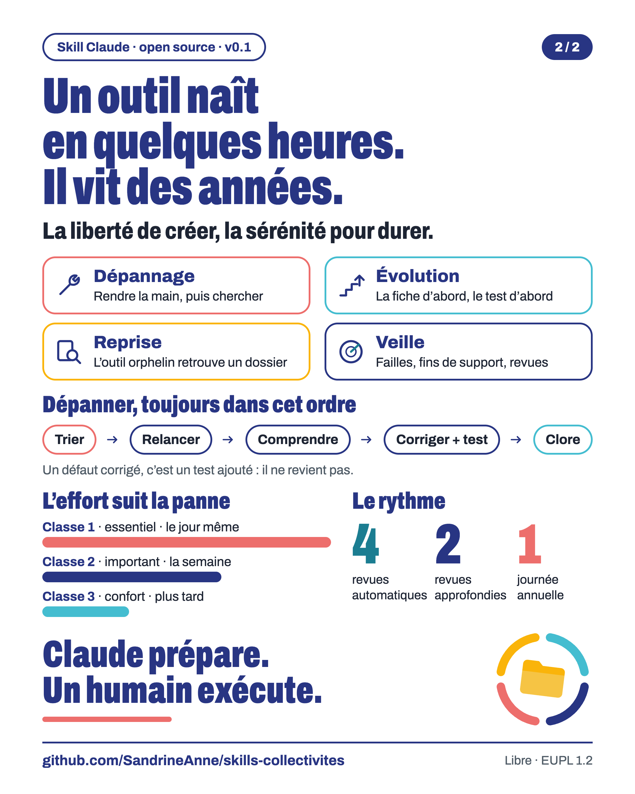

# Fabriquer et entretenir des outils avec l’IA — deux skills Claude

**Version 0.1.0 · première ébauche publique · à tester, critiquer, améliorer.**

Avec Claude, un agent peut fabriquer lui-même, en quelques heures, l’outil dont son service a besoin. Entretenir cet outil dure des années. Ces deux skills génériques encadrent les deux temps, pour toute collectivité ou administration qui veut laisser ses agents créer sans renoncer à la sûreté. Elles sont nées d’un premier usage au Département du Loiret ; nous les partageons pour que d’autres les essaient et nous aident à les améliorer.

<p align="center">
  
  
</p>

| Skill | À quoi elle sert |
|---|---|
| [`fabrique-outils`](skills/fabrique-outils) | Fabriquer un outil : questions en mots simples, fiche d’une page validée avant de coder, contrôle automatique, paquet d’installation pour la DSI |
| [`entretien-outils`](skills/entretien-outils) | L’entretenir : dépannage, évolution, reprise d’un outil sans dossier, veille, revue annuelle du parc |

Un même dossier suit chaque outil de la fabrication à l’entretien.

## Les principes

- **Libérer la création, cadrer sans freiner.** Le socle de sûreté s’applique toujours, même à un brouillon : aucun secret dans le code, aucune donnée réelle de personne, aucun appel vers Internet non déclaré, aucun code dangereux. Le reste (documentation, tests, composants à jour) n’est exigé que lorsque l’outil est installé pour d’autres.
- **La méthode suit le risque, pas la durée.** Un curseur à quatre niveaux : jetable, partagé, durable, avis d’abord.
- **L’entretien suit ce que coûte une panne.** Trois classes d’outils, un mode dégradé pour les outils essentiels, une journée d’entretien par an.
- **Claude prépare, une personne habilitée exécute** en production.

## Essayer les skills

1. Lire [`docs/adapter-a-votre-collectivite.md`](docs/adapter-a-votre-collectivite.md) et remplir `skills/fabrique-outils/references/environnement-collectivite.md`.
2. Fabriquer les paquets : un fichier `.skill` par dossier de `skills/` (archive zip du dossier), ou les télécharger depuis la page des versions du dépôt.
3. Les ajouter à Claude comme skills (claude.ai ou Claude Cowork), selon la documentation d’Anthropic sur les skills.
4. Lancer les essais automatiques (Python 3.10+, bibliothèque standard ; Node.js facultatif) :

```bash
python3 skills/fabrique-outils/scripts/autotest_fabrique.py
python3 skills/entretien-outils/scripts/autotest_entretien.py
```

## Ce qui n’est pas encore fait

C’est une ébauche, et nous le disons franchement :

- les skills n’ont pas encore été éprouvées sur un vrai incident ;
- les playbooks de déploiement n’ont été essayés qu’avec un moteur de conteneurs simulé ;
- les cas d’essai du comportement de Claude (`evals/evals.json`) n’ont pas encore été joués ;
- la grille de vigilance est un modèle vide : chaque collectivité la remplit avec sa cybersécurité ;
- le contenu est en français et pensé pour une collectivité française.

## Contribuer

Vos retours d’essai nous intéressent autant que vos corrections : voir [`CONTRIBUTING.md`](CONTRIBUTING.md). Pour une question de sécurité, voir [`SECURITY.md`](SECURITY.md).

## Licence

[EUPL 1.2](LICENSE), licence européenne avec obligation de réciprocité, inscrite parmi les licences que l’administration peut utiliser pour ses logiciels (code des relations entre le public et l’administration, art. D323-2-1). Une amélioration diffusée profite à tous.

Titulaire des droits : Département du Loiret (code de la propriété intellectuelle, art. L113-9). Ce dépôt est publié avec son accord, qui seul permet de concéder la licence.

Aucune garantie, aucun support n’est promis : ces skills sont partagées en l’état, dans un esprit de partage entre collectivités.
